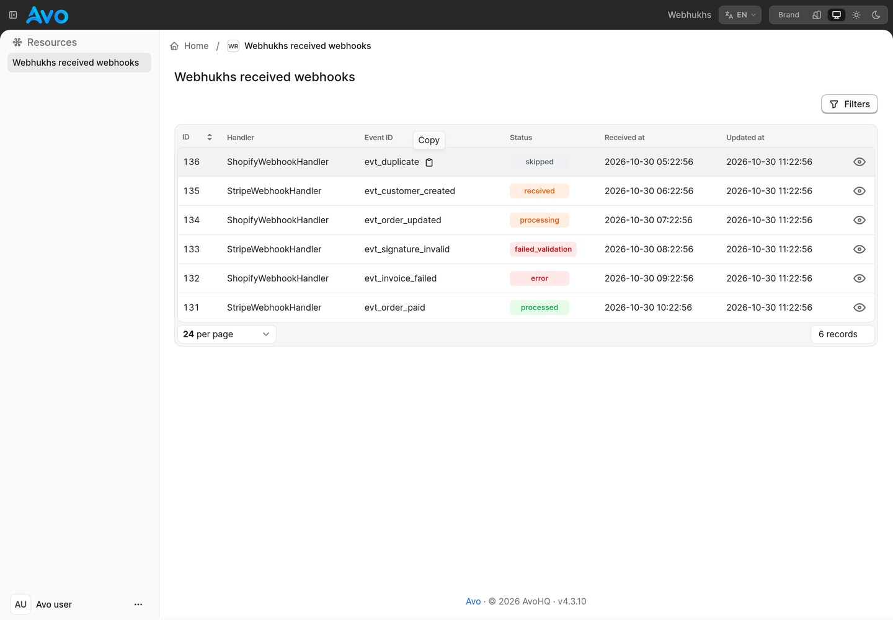
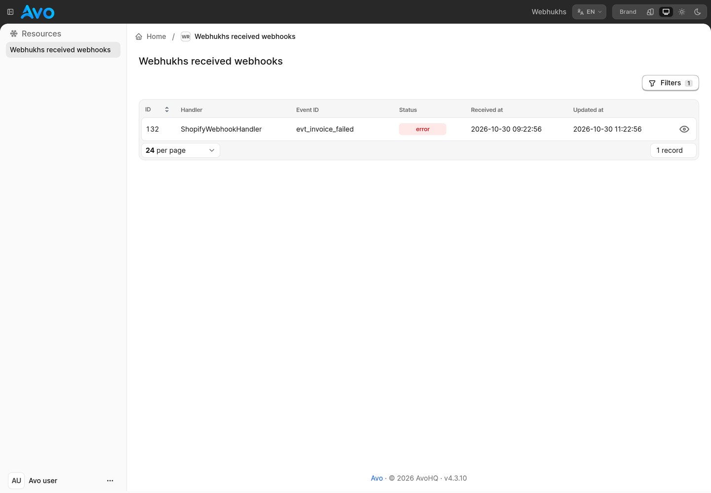
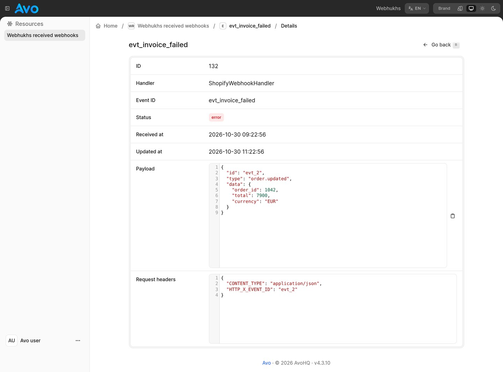

# Webhukhs blueprint for Avo

Inspect incoming webhooks alongside the rest of your Rails app in Avo. Find failed deliveries by status or handler, then open the payload and request headers without changing the stored webhook.

## What you get

1. A read-only resource for `Webhukhs::ReceivedWebhook`.
2. Status badges for received, processing, processed, skipped, failed validation, and error states.
3. Status and handler filters, including handlers no longer registered in your app.
4. JSON-formatted payloads and request headers, with plain-text fallback for non-JSON bodies.
5. No create, edit, delete, or replay controls. Direct write requests are rejected too.
6. Copy webhook IDs and event IDs from rows or details, and copy the displayed payload from details, matching the original admin's copy controls.

Uses Avo's built-in fields and filters. No dashboard, custom component, or paid add-on is required.

## Screenshots

### Webhook list



### Filtered errors



### Payload and request headers



## Install

1. Install [Avo](https://docs.avohq.io/4.0/installation.html) and [Webhukhs](https://github.com/skatkov/webhukhs). This blueprint targets Avo 4 and Webhukhs 0.8.2 on Rails 7.2 or newer, with the Ruby version required by your Rails and Avo versions.
2. Run `bin/rails generate webhukhs:install`, then `bin/rails db:migrate`. Configure and mount Webhukhs as described in its README. You do not need `webhukhs/admin` or its separate admin engine.
3. Apply the blueprint:

```sh
bin/rails app:template LOCATION=https://avohq.io/blueprints/webhukhs.template
```

Restart your Rails server. With Avo mounted at `/admin`, open `/admin/resources/webhukhs_received_webhooks`.

If you have a custom Avo menu, add this entry inside your existing menu block:

```ruby
resource :webhukhs_received_webhooks, label: "Webhooks"
```

The generated files belong to your app. Review them before deploying and customize them as needed. Rails will ask before overwriting an existing file.

## Security and display limits

1. Keep Avo behind your existing admin authentication and authorization. This blueprint does not grant access, add an authentication system, or change your Avo configuration. Every user allowed to view this resource can see its payloads and headers, which may include secrets and personal data. Restrict access accordingly.
2. The controller permits only GET requests to the index and show actions. Hiding buttons alone is not the write protection.
3. Payload display is capped at 256 KiB to avoid rendering very large bodies. Invalid UTF-8 bytes are replaced for display. Neither changes the stored bytes. JSON bodies within the limit are pretty-printed; other bodies are shown as text.
4. The list sorts by primary key, descending, to use the existing primary-key index. Use integer or UUIDv7 IDs for chronological ordering. Random UUIDv4 IDs do not sort chronologically. Other columns are intentionally not sortable.
5. Reprocessing is intentionally excluded. Replaying a webhook can repeat external side effects and needs an application-specific policy.

## Development

`template/` contains the files copied into the host app. `template.rb` is the Rails application template. HQ replaces its `# Insert templates here` marker with a `files` hash, following the existing Avo blueprint format.

Run the integration tests with:

```sh
bundle install
bundle exec ruby test/integration_test.rb
```

Contributions: [avo-hq/webhukhs-app-blueprint](https://github.com/avo-hq/webhukhs-app-blueprint).
